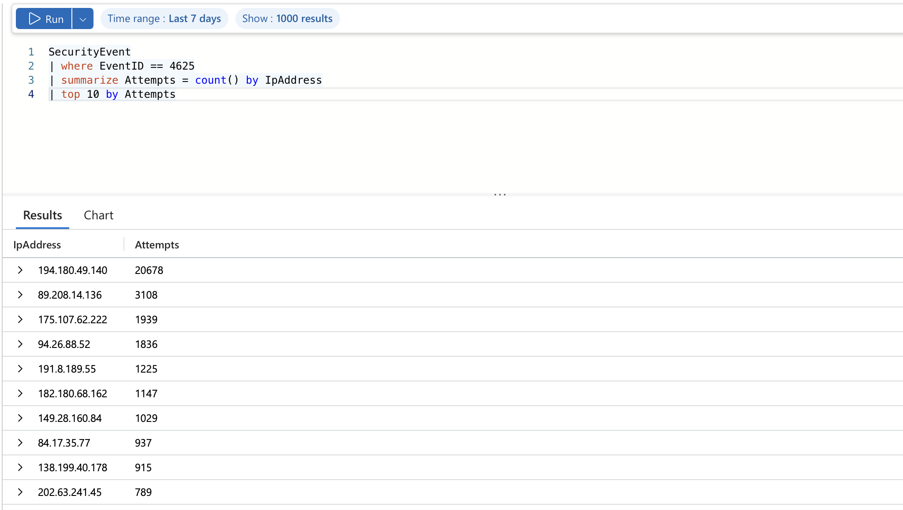
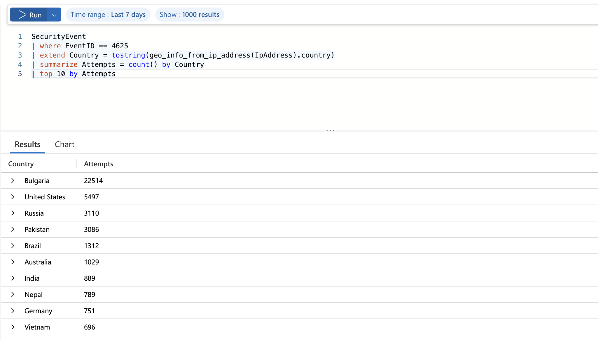
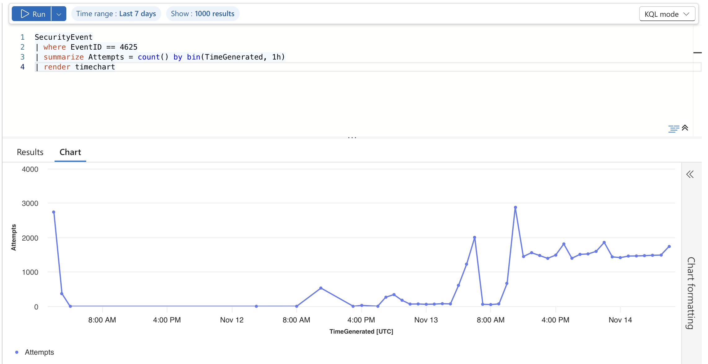
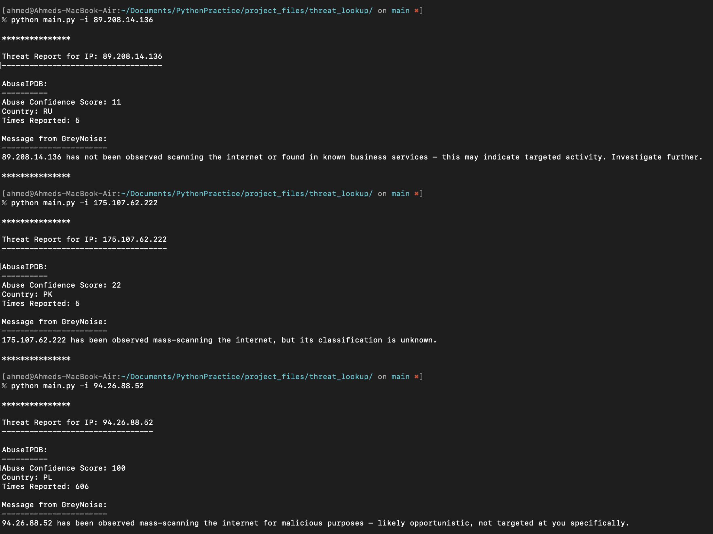

# Azure Sentinel Honeypot Lab

## Overview

This project is a hands-on security operations lab built in Microsoft Azure. A Windows virtual machine was deliberately exposed to the public internet to act as a honeypot. Failed RDP logon attempts (Windows Security Event ID 4625) were collected into a Log Analytics workspace and analyzed in Microsoft Sentinel using KQL to identify the top attacking IP addresses, where the attacks came from, and how activity changed over time.

The most active attacking IPs were then checked against external threat intelligence (AbuseIPDB and GreyNoise) using my own Python tool, [threat-ip-checker](https://github.com/codesbyahmed/threat-ip-checker), to tell opportunistic mass scanners apart from possibly targeted activity.

The goal of the lab was to practice real-world SOC skills: log ingestion, SIEM configuration, threat hunting with KQL, and enriching alerts with threat intelligence.

## Architecture

```
  Internet attackers
          |
          |  RDP brute force (TCP 3389)
          v
+---------------------------+
|  Azure Windows VM         |
|  (honeypot, open NSG)     |
|  Windows Security Log     |
|  Event ID 4625            |
+---------------------------+
          |
          |  Azure Monitor Agent / Data Collection Rule
          v
+---------------------------+
|  Log Analytics Workspace  |
|  SecurityEvent table      |
+---------------------------+
          |
          v
+---------------------------+       +---------------------------+
|  Microsoft Sentinel       | ----> |  threat-ip-checker        |
|  KQL hunting queries,     |  top  |  (Python)                 |
|  geo_info_from_ip_address |  IPs  |  AbuseIPDB + GreyNoise    |
+---------------------------+       +---------------------------+
```

## Tools Used

- Microsoft Azure (Virtual Machines, Network Security Groups)
- Azure Log Analytics Workspace
- Microsoft Sentinel (SIEM)
- Kusto Query Language (KQL), including the built-in `geo_info_from_ip_address()` function for geolocation
- Python with the AbuseIPDB and GreyNoise APIs ([threat-ip-checker](https://github.com/codesbyahmed/threat-ip-checker))
- Remote Desktop Protocol (RDP)

## Setup Steps

1. **Create a resource group** in Azure to hold all lab resources.
2. **Deploy a Windows VM** and configure its Network Security Group to allow all inbound traffic so it is discoverable by attackers on the internet.
3. **Disable the Windows Firewall** inside the VM so connection attempts reach the system and generate logs.
4. **Create a Log Analytics workspace** to store collected logs.
5. **Enable Microsoft Sentinel** on the Log Analytics workspace.
6. **Connect the VM to the workspace** using the Windows Security Events data connector (Azure Monitor Agent with a Data Collection Rule) so Security Event logs, including Event ID 4625, are ingested.
7. **Run the KQL queries** in the `queries/` folder to investigate failed logons.
8. **Check the top attacking IPs** against threat intelligence with `threat-ip-checker`.
9. **Tear down resources** when finished to avoid ongoing costs and risk.

## KQL Queries

| Query | Description |
|-------|-------------|
| [top-10-ips.kql](queries/top-10-ips.kql) | The 10 source IP addresses with the most failed logon attempts. |
| [top-10-countries.kql](queries/top-10-countries.kql) | Geolocates each source IP with `geo_info_from_ip_address()` and ranks the 10 countries with the most attempts. |
| [activity-chart.kql](queries/activity-chart.kql) | Counts failed logon attempts per hour and renders them as a time chart. |

## Findings

All results below cover the last 7 days of data in the workspace (the VM was exposed from about Nov 11 to Nov 14, 2026).

### Top 10 attacking IPs

| IP Address | Attempts |
|------------|---------:|
| 194.180.49.140 | 20,678 |
| 89.208.14.136 | 3,108 |
| 175.107.62.222 | 1,939 |
| 94.26.88.52 | 1,836 |
| 191.8.189.55 | 1,225 |
| 182.180.68.162 | 1,147 |
| 149.28.160.84 | 1,029 |
| 84.17.35.77 | 937 |
| 138.199.40.178 | 915 |
| 202.63.241.45 | 789 |

A single IP, 194.180.49.140, made more failed logon attempts than the other nine combined.



### Top 10 attacking countries

| Country | Attempts |
|---------|---------:|
| Bulgaria | 22,514 |
| United States | 5,497 |
| Russia | 3,110 |
| Pakistan | 3,086 |
| Brazil | 1,312 |
| Australia | 1,029 |
| India | 889 |
| Nepal | 789 |
| Germany | 751 |
| Vietnam | 696 |



### Activity over time

Attempts arrived in bursts at first: a spike of about 2,700 per hour right after exposure, then a long quiet period. From Nov 13 onward the attacks became sustained, holding steady at roughly 1,400 to 1,900 attempts per hour, with a peak near 2,900 per hour.



### Threat intelligence lookup

Three of the attacking IPs were checked against AbuseIPDB and GreyNoise:

| IP Address | AbuseIPDB Score | Country (AbuseIPDB) | Times Reported | GreyNoise Assessment |
|------------|----------------:|---------------------|---------------:|----------------------|
| 89.208.14.136 | 11 | RU | 5 | Not seen scanning the internet or in known business services, so this may be targeted activity. |
| 175.107.62.222 | 22 | PK | 5 | Seen mass-scanning the internet, classification unknown. |
| 94.26.88.52 | 100 | PL | 606 | Seen mass-scanning the internet for malicious purposes, so this is likely opportunistic. |

Note that the country reported by AbuseIPDB does not always match Sentinel's geolocation, because IP geolocation databases differ.



## Lessons Learned

- A VM with RDP open to the internet is found and attacked very quickly, and the volume can reach thousands of attempts per hour.
- Attack traffic is heavily concentrated: one IP accounted for more than half of all attempts in the top 10.
- KQL's built-in `geo_info_from_ip_address()` geolocates IPs without having to upload and maintain a GeoIP watchlist.
- A high attempt count alone does not show intent. Threat intelligence helps separate known mass scanners (high AbuseIPDB score, flagged by GreyNoise) from low-reputation IPs that may need a closer look.
- Geolocation results vary between data sources, so a single source should not be treated as definitive.
- Lab resources should be torn down after use to avoid ongoing cost and risk.

## Credits

This lab was built by following this video tutorial: [Azure Sentinel honeypot lab walkthrough (YouTube)](https://www.youtube.com/watch?v=yVqgpcyq9y4&t=36s). The threat intelligence enrichment step with [threat-ip-checker](https://github.com/codesbyahmed/threat-ip-checker) is my own addition.

---

**Disclaimer:** This lab intentionally exposed a VM to the internet for educational purposes in an isolated environment. Do not replicate this on production systems or networks.
